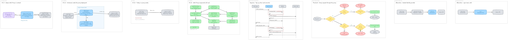
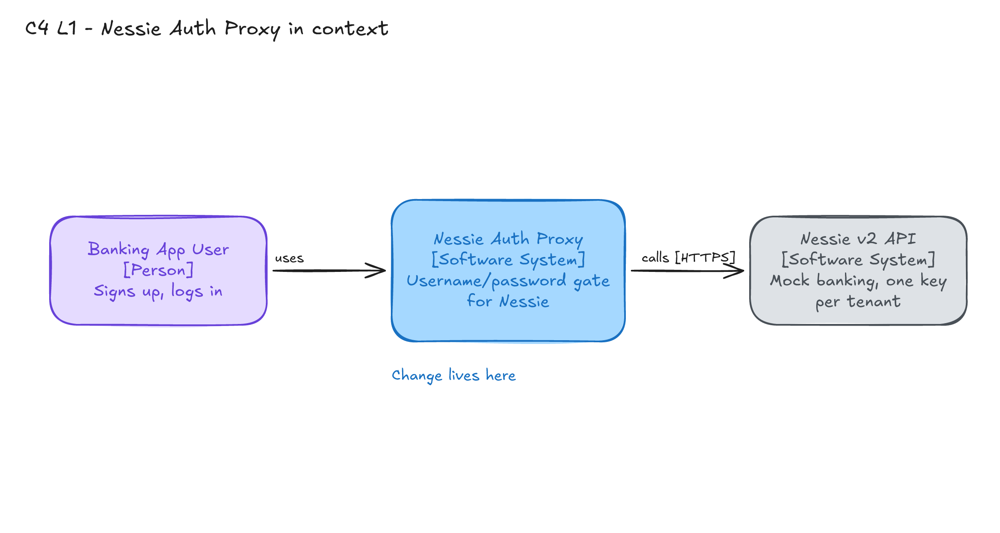
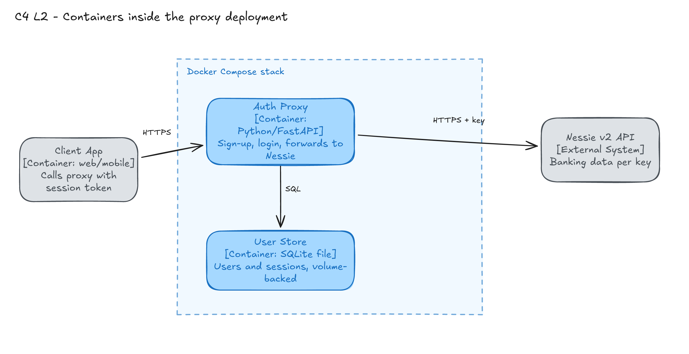
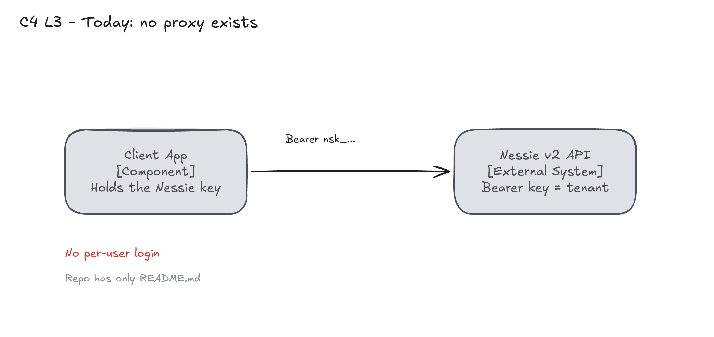
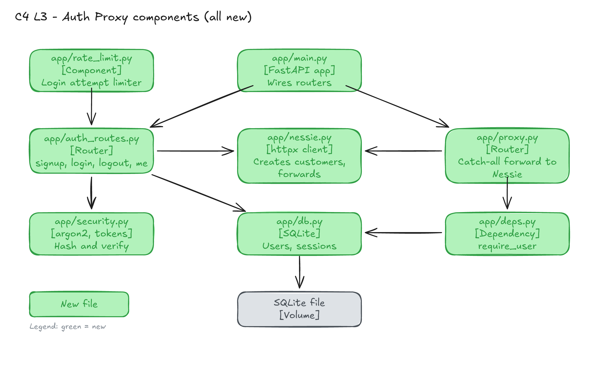
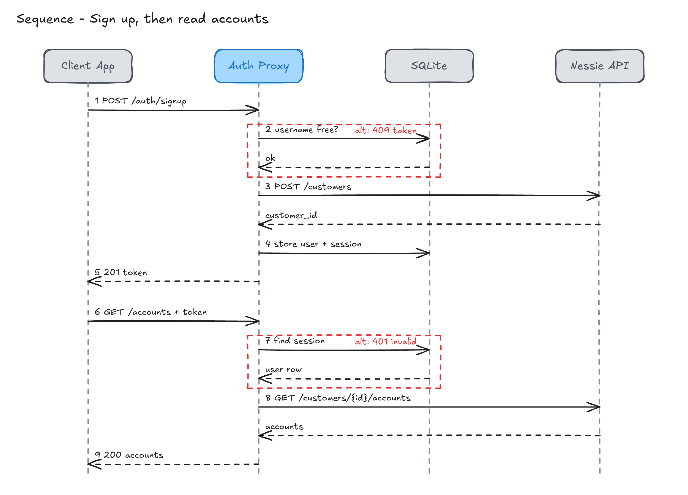
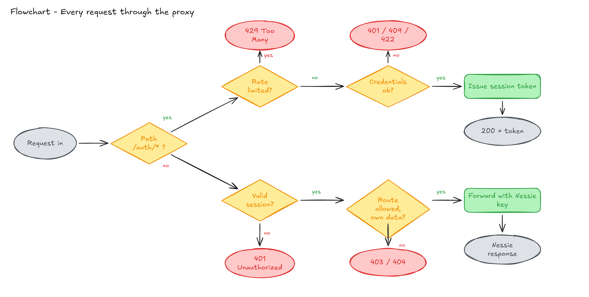
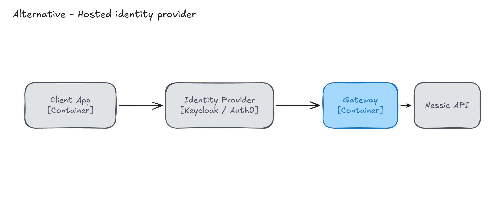
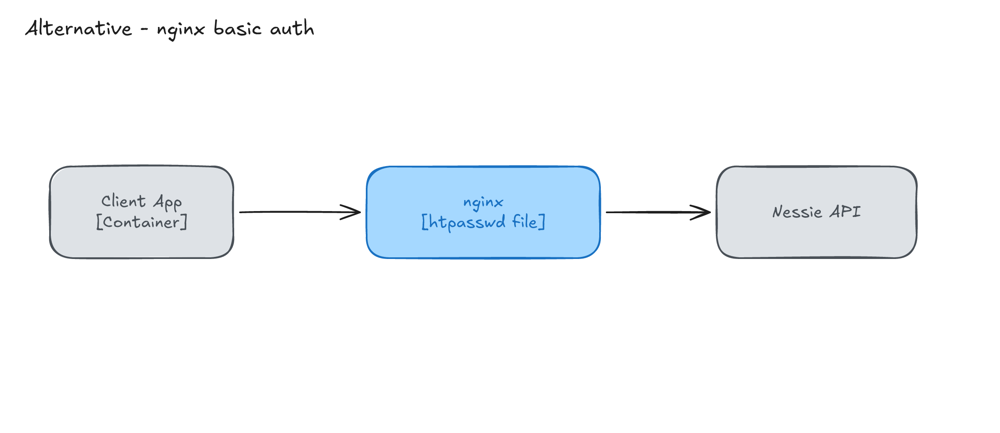

# Dockerized Nessie auth proxy (sign up / log in)

> **Status:** Draft · awaiting review   **Date:** 2026-10-16
> **Live canvas:** https://draw.ehlops.com. Leave sticky notes next to anything you want to discuss.
> **Scene file:** [diagrams/scene.excalidraw](diagrams/scene.excalidraw)

## TL;DR
- Nessie v2 has **no user login**. It has one bearer API key per tenant (`bearerAuth`, `openapi.yaml:1563`), and every customer and account lives under that key.
- Proposal: a small Docker container (Python/FastAPI + SQLite) that holds the Nessie key server-side and adds **username/password sign-up and login**. Logged-in users get a session token and call Nessie *through* the proxy.
- Each proxy user is tied to one Nessie **customer** (`POST /customers`, created at sign-up), which is what "their account" means.
- Scope is only sign-up/login plus a gated pass-through. Per-user data isolation is the big open decision (below).
- Docker is not installed on this machine, so I could not build the image here; the plan includes a verify step for that.

## Decisions needed
Resolved by the user on 2026-10-16:
1. **Data isolation: A (gate only).** Any logged-in user may call any Nessie route; all users share one tenant. Step 5 (ownership scoping) is dropped. Consequence: `/admin/*` and `DELETE /data` are reachable by every logged-in user; revisit if that matters.
2. **Sign-up collects first name, last name and address**; the Nessie customer is created at sign-up.
3. **Stack: Python/FastAPI + SQLite.**

## System context

Two boxes plus a person, so this is deliberately small: users talk to the proxy, the proxy talks to Nessie. Nothing else is involved.

Two containers in one Docker Compose stack: the proxy and a SQLite file on a named volume. SQLite avoids a second database container for a hackathon-sized user table; the file survives restarts via the volume.

## How it works today

Nothing exists in this repo yet (`README.md` only). Today a client would call Nessie directly with the tenant key, so the key sits in every client and there is no concept of a user. This view is intentionally tiny for that reason.

## Proposed design

Everything is new (green). Responsibilities:
- `auth_routes.py` handles `/auth/signup|login|logout|me`.
- `security.py` hashes passwords (argon2id) and mints/verifies session tokens. Tokens are random 256-bit values; only their SHA-256 is stored, so a database leak does not leak live sessions.
- `db.py` owns two tables: `users(id, username UNIQUE, password_hash, nessie_customer_id)` and `sessions(token_hash, user_id, expires_at)`.
- `deps.py` provides `require_user`, used by the catch-all route.
- `proxy.py` forwards everything else to Nessie at the **same paths**, so a client switches only its base URL. It strips the client's `Authorization` header and injects the real key.
- `nessie.py` is the only module that knows the Nessie key.
- `rate_limit.py` throttles login/sign-up per IP and username (in-memory; fine for a single container).

Example API shape and env vars: [examples/proposed-auth-api.md](examples/proposed-auth-api.md).

### Sequence

Sign-up checks the username *before* creating the Nessie customer (messages 2-3) so a taken username never leaves an orphan customer. If the final insert still loses a race on the UNIQUE constraint, the proxy deletes the just-created customer (best effort). Session lookup (7) failing returns 401 before Nessie is ever contacted.

### Flow

`/auth/*` is handled locally and rate-limited first; everything else needs a valid session and then an allow/ownership check. Under the chosen decision 1A the "allowed, own data?" diamond always answers yes; it is kept on the canvas as the hook for adding scoping later.

## Alternatives considered

### Alternative A: Hosted identity provider (Keycloak / Auth0) in front

- **What:** delegate sign-up/login to an IdP; a thin gateway validates its tokens and forwards to Nessie.
- **Pros:** production-grade auth, MFA, password reset for free.
- **Cons:** extra container or SaaS account, config-heavy, still needs custom code to map users to Nessie customers.
- **Why not:** far more setup than a hackathon needs for plain username/password, and the user-to-customer mapping is custom either way.

### Alternative B: nginx basic auth

- **What:** nginx with an htpasswd file in front of Nessie, injecting the key.
- **Pros:** about ten lines of config, tiny image.
- **Cons:** no sign-up endpoint, accounts edited by hand, no link from a user to a Nessie customer, credentials resent on every request.
- **Why not:** the request is explicitly for sign-up and login; basic auth supports neither.

### Alternative C: Do nothing (use Nessie keys directly)
- **What:** hand each person a key from the Nessie docs site (GitHub sign-in).
- **Why not:** no username/password, the key is a bearer secret living in the client, and it is not per-end-user.

### Comparison
| Criterion | Proposed | A: IdP | B: nginx | C: Nothing |
|-----------|----------|--------|----------|------------|
| Sign-up + login | ✅ | ✅ | ❌ | ❌ |
| User tied to a Nessie customer | ✅ | ⚠️ custom | ❌ | ❌ |
| Key hidden from clients | ✅ | ✅ | ✅ | ❌ |
| Setup effort | ⚠️ moderate | ❌ high | ✅ low | ✅ none |

## Implementation steps
1. Scaffold `app/` with config, `/health`, `Dockerfile`, `docker-compose.yml` (volume `/data`, env file). Verify: `docker compose up`, `curl /health`.
2. `db.py` + `security.py`; unit tests for hashing and session expiry.
3. `auth_routes.py` + `nessie.py` customer creation; tests with Nessie mocked.
4. `proxy.py` + `deps.py`: forward with key injection; test that client `Authorization` is never forwarded.
5. (Dropped: ownership scoping, per decision 1A.)
6. `rate_limit.py`; README with run instructions.

## Risks & mitigations
| Risk | Likelihood | Impact | Mitigation |
|------|-----------|--------|------------|
| Nessie key leaks to a client | Low | High | Key only in `nessie.py`; strip inbound `Authorization`; tests assert it |
| Any user reads other users' data (shared tenant) | High under 1A | High | Accepted under 1A; add a route allowlist later if needed |
| Orphan Nessie customers from failed sign-ups | Medium | Low | Uniqueness check first; best-effort cleanup |
| Login brute force | Medium | Medium | argon2id, per-IP/username limiter |
| In-memory limiter resets on restart / single replica only | Medium | Low | Acceptable for hackathon; note in README |
| Image not built or tested here (no Docker locally) | Certain | Medium | Build and smoke test in step 1 on a machine with Docker |

## FAQ
**Why opaque sessions instead of JWT?** They are revocable (logout works) and the lookup is one SQLite read. JWT would add key management for no benefit with a single container.

**Does the proxy change Nessie's API?** No. Same paths, methods and bodies; only authentication differs.

**What about Nessie's own rate limit (120/min per key)?** All users share one key, so they share that budget. The proxy should pass through `429`/`Retry-After`. Flagged as a limitation of one-key-for-all-users.

**What happens when Nessie is down at sign-up?** Return 502 and create no user row.

**Can users reach admin or destructive routes?** Yes under 1A, including `DELETE /data`, which wipes the whole tenant. Accepted for now.

**Where is data stored and how do we back it up?** `/data/proxy.db` on a named Docker volume; copy the file.

**TLS?** The container speaks HTTP; terminate TLS in front (platform load balancer or Caddy). Passwords must never travel over plain HTTP outside localhost.

**How do we roll back?** Remove the container; clients point back at Nessie. No Nessie-side schema changes.

## Open questions
- Deployment target (local only, or a hosted container)? It affects TLS and where the volume lives.

## Artifacts
- `diagrams/` holds the canvas scene, `00-overview.png` and one PNG per frame, each embedded above.
- `examples/proposed-auth-api.md`: endpoint shapes and environment variables for the proxy.

## Feedback log
| # | Comment (where) | Response | Changed |
|---|-----------------|----------|---------|
